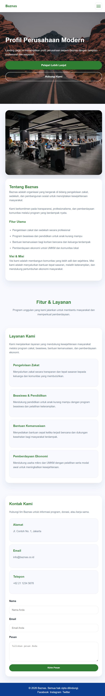
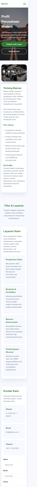
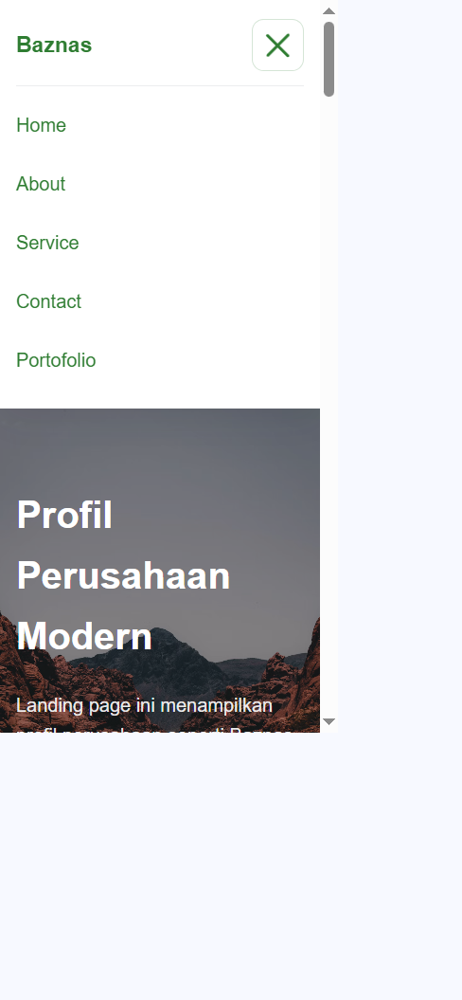

# Landing Page Perusahaan

Landing page statis untuk profil perusahaan/organisasi (Baznas) dengan tampilan modern dan responsif di desktop maupun mobile.

## Fitur

- **Navigasi responsif** dengan menu hamburger di perangkat mobile.
- **Hero section** dengan call-to-action.
- **Tentang Kami** berisi profil, fitur utama, serta visi dan misi.
- **Layanan** ditampilkan dalam kartu layanan.
- **Kontak** berisi informasi alamat, email, telepon, dan formulir kontak.
- **Form kontak** menyimpan data input ke `localStorage` browser sebagai simulasi.

## Teknologi

- HTML5
- CSS3
- JavaScript (Vanilla)

## Struktur Project

```text
.
├── docs/
│   └── screenshots/
│       ├── desktop.png
│       ├── mobile.png
│       └── mobile-menu.png
├── img/
│   └── background.jpg
├── index.html
├── scriptJS/
│   └── index.js
└── style/
    └── styles.css
```

## Cara Menjalankan

Karena project ini statis, kamu bisa langsung membuka `index.html` di browser. Untuk pengalaman yang lebih baik, jalankan server lokal:

### Python

```bash
python -m http.server 8080
```

Lalu buka `http://localhost:8080`.

### VS Code Live Server

1. Install extension **Live Server**.
2. Klik kanan `index.html`.
3. Pilih **Open with Live Server**.

## Dokumentasi

### Tampilan Desktop



### Tampilan Mobile



### Menu Mobile



## Catatan

- Form kontak belum terhubung ke backend; data hanya disimpan di `localStorage`.
- Gambar hero menggunakan gambar dari Unsplash melalui URL eksternal.
